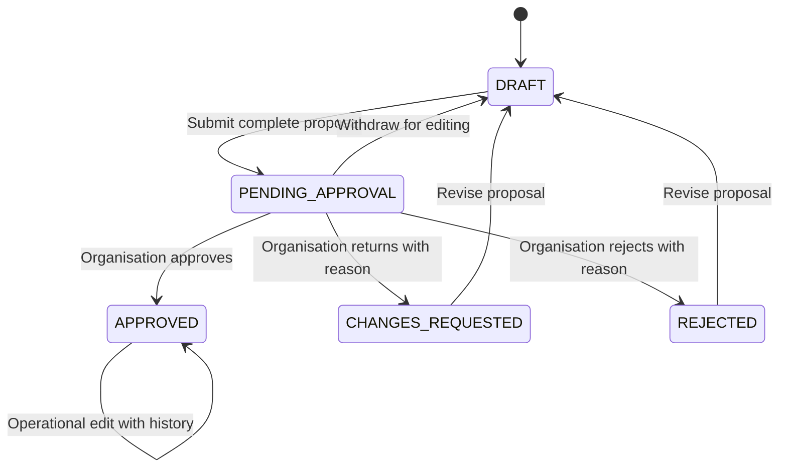
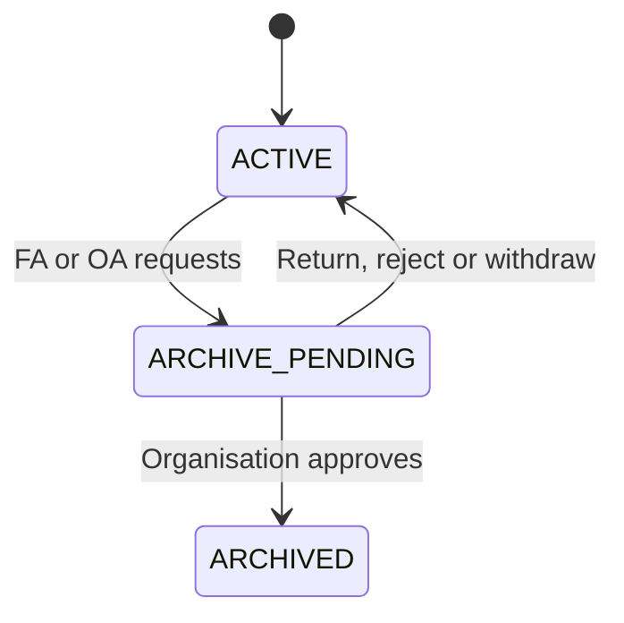

# GSLA-M1-009 — Facilities / Venues Approval Architecture

**Version:** 1.0 proposed architecture · **Date:** 2026-10-12

**Worker:** Software Architect · **Disposition:** Ready for Project Controller / Project Owner review; not approved for implementation by this document alone.

**Source baseline:** `eb4dc64a176addc6172d98518001bd5065a8eecd` on GitHub `main`.

**Authority:** [Issue #43](https://github.com/gibfesta/gsla-new-sdu/issues/43), [Breeze M1-009](https://app.breeze.pm/cards/6533385), [approved active M1 / Facilities policy v0.2](../data-ownership-and-access.md), [M1-004 findings](../project-control/GSLA-M1-004-BACKEND-VERIFICATION.md).

**Evidence limits:** Source and task-record review only. No production implementation, live database inspection, RLS/grants certification, authenticated runtime tests, or deployment verification.

## 1. Decision and approved-policy traceability

Use a Facilities-owned approval service with explicit commands. Keep three separate concepts: initial approval, archival, and operational condition. An Operational, Limited or Closed label is never evidence of approval. Do not build a generic cross-department workflow engine for this milestone.

| Approved v0.2 business rule | Architectural consequence |
| --- | --- |
| Facilities Administrator can create/edit a proposed venue | Server-persisted draft and editable preparation flow; creation never publishes a formally approved venue |
| Organisation Administrator approves new venues | Only `organisation_admin` can decide initial approval; preserve submitted content and decision evidence |
| Facilities Administrator continues managing/editing operational details after approval | Operational edits apply immediately, retain approval, and produce revisions/history; do not add mandatory reapproval or an approver-only field lock |
| Organisation Administrator approves archival | Facilities Administrator requests archival; only Organisation Administrator can execute the archive transition |
| Organisation Administrator has full app rights | May prepare, submit and decide their own record; do not invent a second approver or prohibit self-approval |
| Centre Manager has assigned-venue scope and retained personal contribution history | No venue master-record preparation, approval or archival authority; eventual scoped read/history integration is M1-007, not a new grant here |

This model implements existing authority. Submission mechanics, immutable review snapshots and version checks are technical safeguards, not changes to who has business permission. No HR/Finance/SDU role is added. A multi-role caller with `organisation_admin` is evaluated with Organisation Administrator authority; ownership does not override roles.

## 2. Current state audit and affected boundaries

| Source inspected | Current behaviour / implementation gap |
| --- | --- |
| `lib/auth/access.ts` | Verified Supabase user and session-based role lookup; `requireFacilityAccess` admits Organisation/Facilities Administrators but does not distinguish approval commands |
| `app/api/facilities/route.ts` | GET returns all saved rows; POST creates a venue directly without preparation/approval state or audit decision |
| `app/api/facilities/[id]/route.ts` | GET/PATCH use role guard; PATCH updates mutable data directly; DELETE is fail-closed after M1-004 (401/403/409 source expectations, not runtime results) |
| `prisma/schema.prisma` | `Facilities_Table` has operational status, contact fields and schedule; lacks workflow state, revisions, request history and approval/archival evidence; multi-column primary key includes mutable values |
| `components/facilities/FacilityForm.tsx` | Create/Edit share the current visible field contract; POST/PATCH currently redirect into venue information |
| `components/facilities/useSavedFacilities.ts`, `SavedFacilityInformation.tsx` | Read saved venue data with no approval/lifecycle projection |
| `app/facilities/home/page.tsx`, directory page, `FacilitiesSidebar.tsx` | Saved venues feed overview/navigation; need distinct operational vs preparation queries |
| `app/facilities/facilities-directory/[facilityId]/archive/page.tsx` | Disabled UI placeholder; no real archive request or decision |
| `app/facilities/layout.tsx`, `app/organisation/layout.tsx`, `middleware.ts` | Department/session admission exists; actions must still enforce command-level authority |

Retain existing page routes, field labels, theme and redirect compatibility. The new endpoints below are proposed, not deployed routes. Existing venue IDs and relationships must be preserved through migration. Manager names/contact fields are descriptive; saving them must not grant roles or venue assignments.

## 3. State vocabulary and invariants

### Facility aggregate

- `approvalState`: `DRAFT`, `PENDING_APPROVAL`, `CHANGES_REQUESTED`, `REJECTED`, `APPROVED`, or migration-only `LEGACY_UNVERIFIED`.
- `lifecycleState`: `ACTIVE` or `ARCHIVED`. ACTIVE on a draft means a retained, unarchived record; it does not make it operationally available.
- `operationalStatus`: existing `status` contract, currently `Operational`, `Limited`, `Closed`; retain current storage mapping. Validation/legacy normalisation is a separate reviewed mapping, never silently substitute approval values.
- `recordVersion`: monotonically increasing on every successful aggregate command, including decisions/request changes.
- `contentVersion`: monotonically increasing only when venue information changes; decision snapshots bind to this value.
- `pendingRequestId`, `initialApprovalRequestId`, `approvedContentVersion`, and archival attribution reference the corresponding recorded decisions. Decision times and actor IDs come from the server.

`eligibleForNewOperationalUse = approvalState === APPROVED && lifecycleState === ACTIVE`. Queries for real venue selectors, new assignments and future operational records use this predicate; administrative preparation/history views use an explicitly authorised query. Closed is not archived; archived is not rejected; pending is not approved. Existing activity/history is never erased by these state changes.

### Approval requests

Each request has immutable identity, `facilityId`, `kind` (`INITIAL_APPROVAL` or `ARCHIVE`), submitted `contentVersion`, review snapshot, request version, requester/submitter attribution, dates, reason and eventual decision. Request states: `PENDING`, `RETURNED`, `REJECTED`, `WITHDRAWN`, `APPROVED`, `SUPERSEDED`.

One open PENDING request per facility. A new submission creates a new request identity; never overwrite a rejected/returned/withdrawn/approved request. There is no separate editable approval-request draft: the facility preparation record is the draft; the archive form can collect a reason before submitting.

Approval is for the exact snapshot submitted. A later operational edit does not falsely make that new content the original approved snapshot. Show both initial approval and latest information revision when relevant.

### Initial state diagram

Archival changes lifecycleState, not the initial APPROVED evidence. Migration-only LEGACY_UNVERIFIED is handled in section 11.

## 4. Explicit initial-approval transitions

FA = Facilities Administrator (`facilities_admin`); OA = Organisation Administrator (`organisation_admin`). All preparation authority is Facilities-wide under the approved default, not creator-only. CM and anonymous callers cannot perform these commands.

| Command | From | To / request result | Authority | Preconditions and effects |
| --- | --- | --- | --- | --- |
| Create proposal | No record | DRAFT + ACTIVE | FA / OA | New immutable UUID; supplied fields validated; server attribution; no auto-approval even for OA |
| Prepare legacy record | LEGACY_UNVERIFIED | DRAFT + ACTIVE | FA / OA | Expected recordVersion; preserve original saved data/provenance and validate supplied changes; no invented approval; subsequent OA decision required |
| Save preparation | DRAFT / CHANGES_REQUESTED / REJECTED | DRAFT | FA / OA | Expected recordVersion; save revision and change event; previous decision remains in history |
| Submit initial approval | DRAFT | PENDING_APPROVAL; new PENDING request | FA / OA | Submission validation succeeds; capture full snapshot and contentVersion; no other PENDING request |
| Withdraw submission | PENDING_APPROVAL | DRAFT; request WITHDRAWN | FA / OA | Identify exact PENDING request and expected versions; preserve snapshot; optional explanatory note |
| Revise while pending | PENDING_APPROVAL | DRAFT; request WITHDRAWN | FA / OA | Atomic withdraw plus validated content revision; prevents unseen edits to the submitted snapshot; caller can resubmit afterward |
| Return for changes | PENDING_APPROVAL | CHANGES_REQUESTED; request RETURNED | OA only | Exact request/snapshot still current; non-empty reason; no operational publication |
| Reject proposal | PENDING_APPROVAL | REJECTED; request REJECTED | OA only | Exact request/snapshot still current; non-empty reason; retained administrative record, not deleted/archived |
| Approve proposal | PENDING_APPROVAL | APPROVED + ACTIVE; request APPROVED | OA only | Current proposal contentVersion matches snapshot; submission validation rechecked; record approver/time/policy reference and publish eligibility atomically |
| Edit approved operational information | APPROVED + ACTIVE or ARCHIVED | Same approval/lifecycle | FA / OA | Validate allowed information fields and expected version; save current revision and attributable history; never rewrite decision or restore archived lifecycle |

Pending content is not permanently locked: FA/OA can use revise-while-pending. Any action after role removal is checked against the current verified role set. A PENDING request cannot be approved by editing `status`, changing metadata, importing a browser preview or bypassing the command endpoint.

Approval does not create Centre Manager assignments. OA may create, submit and approve their own proposal using the same evidenced transitions; the API must not infer approval merely from the creator's role. No four-eyes requirement is asserted by v0.2.

## 5. Post-approval editing and input contract

The currently exposed information fields remain the preparation/edit contract: `name`, `type`, `status`, `address`, `area`, `description`, `contact_email`, `contact_phone`, `centre_manager_name`, `centre_manager_title`, `centre_manager_email`, `centre_manager_phone`, `facilities_manager_name`, `facilities_manager_email`, `supported_activities`, `notes`, `opening_schedule`.

Do not silently narrow FA's existing operational editing authority or introduce new field-level approval exceptions. Changes to these information fields preserve APPROVED and produce a new contentVersion, revision and audit event. UUID, workflow states, approver/requester attribution, version counters, archive flags and decision fields are server-owned and must never be accepted as ordinary PATCH fields. Assignments/roles are separate commands under their own model, not text fields in this form. A different physical venue requires a new identity and proposal rather than replacing an approved UUID's meaning.

Archived information corrections remain attributable FA/OA edits; they do not restore availability, cancel archival or delete the archive decision. Unarchive/restore is not provided by M1-009: refer a requested restoration workflow for separate architecture and explicit policy mapping; do not claim that OA's approved full rights have been revoked.

Drafts may contain incomplete information. Required completion must be enforced at submit and approve. Existing form requirements are name and address; validate all supplied types, field sizes, contact formats, supported-activity values, schedule shape and recognised operational status. Use the approved form/catalogue definition and persist its validation version with the submission. This order does not invent mandatory documents or new business fields: record an owner decision if the required checklist changes. Generic browser-local catalogue editing must not be able to weaken server submission validation.

## 6. Archive request and decision model

ARCHIVE_PENDING in this visual is an ACTIVE approved facility with a PENDING archive request, not a third lifecycleState. Approved status and operational condition remain visible separately.

| Command | Preconditions | Authority | Result |
| --- | --- | --- | --- |
| Request archive | APPROVED + ACTIVE, no other PENDING request, reason and expected version | FA / OA | New PENDING ARCHIVE request binds current contentVersion and reason; venue remains ACTIVE pending decision |
| Withdraw archive request | Exact PENDING ARCHIVE request and expected versions | FA / OA | WITHDRAWN; facility stays ACTIVE; no content/history loss |
| Return/reject archive request | Exact PENDING ARCHIVE request and current review version; reason | OA only | RETURNED / REJECTED; facility stays ACTIVE; revised reason submitted as a new request |
| Approve archive | Exact PENDING ARCHIVE request, current snapshot version, valid expected versions | OA only | Request APPROVED, lifecycle ARCHIVED, server actor/time/reason and audit recorded together; no physical deletion |
| Operational edit during archive review | APPROVED + ACTIVE with PENDING ARCHIVE request | FA / OA | Edit allowed; contentVersion increments and prior archive request becomes SUPERSEDED atomically; facility stays ACTIVE; a new request must be submitted against current content |

This supersession never grants FA the ability to archive or approve; it prevents an OA decision from acting on stale information while retaining FA operational editing rights. UI must explain that the request needs resubmission. A new request also re-evaluates related operational commitments visible to the reviewer.

Preserve venue identity, prior versions, assignments and attributable issue/event/handover/history records. Archived venues are excluded from new operational selectors and new operational record creation; administrative history remains available under existing role/scope rules. Do not blanket-revoke a CM's permitted assigned-venue history or personal contributions through archive filtering. M1-007 owns the scoped access implementation.

No automatic cancellation, reassignment, cascade deletion or suppression of future bookings/events is implied. At archive decision time show linked commitments where those data paths exist; future integration must define how outstanding operations are handled, without inventing a new veto/approver in this order. OA confirms the archive effect and reason. Permanent DELETE remains disabled; data erasure/retention is a separate controlled design, not an alias for archive. OA's business Delete authority is unchanged, but this order implements archival only.

## 7. Read model and UI contract

- Existing admin directory: return saved records with approvalState, lifecycleState, operationalStatus, versions, pending request summary and server-derived allowedActions. Clearly label preparation and legacy entries; do not imply that all saved rows are approved.
- Overview / venue choices for new operational use: server query defaults to APPROVED + ACTIVE, not browser-only filtering of an unrestricted list. Closed status remains distinct; domain-specific availability rules still apply.
- Admin detail: authorised FA/OA see draft, submitted snapshot, current content, decisions and history. Archive history is an explicit administrative view. Non-admin scoped projections are deferred to M1-007; never reuse the preparation DTO for CM output.
- Existing Create/Edit routes: Save Draft, Submit for Approval, or Save Operational Changes as appropriate; pending edit uses Revise Proposal / Withdraw + Save. Controls call explicit commands, not localStorage-only success. Surface stale-version errors without losing unsaved input.
- Existing archive route: Request Archive for FA/OA; OA also sees exact pending request/snapshot and Approve Archive / Return / Reject. Keep the existing theme and back-navigation.
- Proposed OA review entry: `/organisation/facility-approvals`, Organisation-only, initially creation and archive requests. Details may reuse read-only Facilities content components; rendering reuse does not share role admission.
- No blanket Centre Manager layout access change in this task. M1-007 must apply approved assigned-venue and personal-working-record scope separately.

No email invitation/notification service is required for correctness. A review queue is sufficient for M1; optional notifications occur after commit and cannot constitute approval or roll back a valid decision if delivery fails.

Consumer migration map: `FacilityForm` reads detail and writes versioned commands; directory explicitly requests preparation view (including approved rows, clearly labelled) with a separate archived view; `home` and new-record venue selectors use operational view; archive page and venue sidebar load authorised detail by UUID rather than searching the default operational list. `SavedFacilityInformation` shows workflow badges separately from operational condition. Preparation rows may open information and workflow history, but must not enter a real operational form/assignment workflow. Current browser-only venue/form previews remain design tools and never confer approval. Every consumer of `useSavedFacilities` must select its purpose explicitly; add a view argument or separate hooks rather than silently changing all callers.

## 8. Server/API contract and module ownership

All endpoint names below are proposed. Existing GET responses can add fields without removing the current information fields. POST/PATCH clients require a coordinated release because POST becomes draft creation and PATCH requires versions/state-specific behaviour.

| Endpoint / command | Allowed caller | Server behaviour |
| --- | --- | --- |
| `GET /api/facilities?view=operational|preparation|archived` | FA / OA for current admin API | Validate view; default operational; explicit preparation/archive views require role; eligibility applied in query |
| `GET /api/facilities/[id]` | FA / OA for current admin API | Authorised record and state/action projection; no role inferred from URL |
| `POST /api/facilities` | FA / OA | Create DRAFT only; key-based idempotency; fields may be incomplete but supplied values validated |
| `PATCH /api/facilities/[id]` | FA / OA | Body `{expectedVersion, information}`; preparation or approved edit per tables above; pending revision atomically withdraws; reject workflow-field injection |
| `POST /api/facilities/[id]/approval-requests` | FA / OA | `{expectedVersion}`; validate and submit immutable INITIAL_APPROVAL request |
| `POST /api/facilities/[id]/archive-requests` | FA / OA | `{expectedVersion, reason}`; create ARCHIVE request, not archive venue |
| `POST /api/facilities/[id]/requests/[requestId]/withdraw` | FA / OA | `{expectedVersion, expectedRequestVersion, note?}`; matching current request only |
| `POST /api/facilities/[id]/requests/[requestId]/decision` | OA only | `{expectedVersion, expectedRequestVersion, decision: APPROVE|RETURN|REJECT, reason?}`; initial or archive transition selected from stored request kind |
| `GET /api/facilities/[id]/history` | FA / OA for current admin API | Paginated revisions/decisions with authorised field projection; CM contribution export integrates separately |
| `GET /api/facility-approval-requests?state=PENDING` | OA only | Organisation review queue; no cross-department role inferred |
| `DELETE /api/facilities/[id]` | Existing fail-closed behaviour | Retain current 401 anonymous / 403 non-OA / 409 OA behaviour until a separately assigned erasure workflow exists; never secretly archive on DELETE |

Suggested ownership (planned files, no file moves): `lib/facilities/approval-model.ts` holds the typed transition definition without persistence; `lib/facilities/approval-service.ts` is server-only and applies actor/action/state/version validation plus transaction; `lib/facilities/facility-repository.ts` is server-only persistence; `lib/facilities/validation.ts` owns server information/submission validation. Existing `lib/auth/access.ts` remains identity/role authority. API handlers and any Server Actions call the same service; no direct mutation bypass in handlers, page code, generic import/export or bulk endpoints. Future workflows may reuse request/audit concepts only after mapping their own approved policy; Events has different information gathering and CM contribution rules.

Execution order for every command:
1. Verify identity and fresh role set; never trust caller-supplied actor, role or user-editable metadata.
2. Validate route UUID/request identity, command shape, supported field allowlist and expected versions. OA decision requires OA authority before fetching private review data.
3. Begin one transaction; read facility/request, recheck state and version, and validate submission requirements where applicable.
4. Conditionally write only the matching version/state, revision/request/decision and audit; no affected row means conflict. A matching request must belong to the supplied facility.
5. Commit all effects together. Audit-write failure must abort the state change. Return the stored outcome; then invalidate authorised caches/review counts. Notification/cache failure does not repeat the command.

Return `401` absent identity, `403` role denial, `404` absent or scope-hidden record, `400` malformed input/unknown fields, `422` incomplete/invalid submission, `409` invalid/stale state/version or idempotency conflict, and generic `500` infrastructure failure with internal correlation ID. Do not return raw SQL/schema errors to clients. Current read permissions do not permit cached shared responses to leak preparation records across roles.

Idempotency: require a caller-generated command key for POST/PATCH/decisions, store scope `(actorId, command, key)` and payload fingerprint plus outcome in the transaction. Same authenticated authorised caller/key/payload returns the original result; same key with different content returns 409. Re-authorise before replay; permission loss must deny even a cached outcome. Different keys racing on one record use compare-and-swap versions; only one wins. Create retries return one UUID. Simultaneous approve/reject/withdraw/operational-edit vs archive-decision must produce one consistent outcome, not two decisions or silent overwrite.

## 9. Audit/history expectations

Every successful command records: facility UUID, aggregate/content version, request ID/kind where applicable, action, before/after state, before/after information or revision references, verified actor UUID, effective role, server UTC timestamp, decision/request reason, policy version (`v0.2`), validation version, command/correlation identity. Failed authorisation attempts belong in restricted security logs, not fabricated business decisions. No passwords/tokens or unnecessary personal information in logs.

Retain immutable submitted snapshots, initial approval, returned/rejected requests, archive reasons/decisions and later operational revisions. Decisions are append-only and cannot be changed through edit forms. User offboarding must not cascade-delete attributable contributions or approvals; Senior Database Engineer defines safe foreign-key/retention handling. Keep the minimum context needed for the approved CM personal contribution history/export; this model does not grant browsing of another person's restricted content. Retention length and permanent erasure rules are not invented by this architecture.

## 10. Senior Database Engineer referral (requirements, not DDL/certification)

| Required invariant / capability | Database specialist work |
| --- | --- |
| One stable venue UUID | Assess existing multi-column primary key and UUID duplicates/nullability; propose a safe unique/canonical key migration preserving IDs, existing references and legacy redirects |
| Distinct workflow and operational state | Design new facility workflow fields/sidecar plus constraints; no overload of `status`; safe defaults must not auto-approve |
| Incomplete server-persisted drafts | Review required/nullable/default columns so missing information can be represented honestly; do not fabricate names/addresses from defaults to pass approval validation |
| Immutable approval/archival evidence | Design request, snapshot/revision and audit relations; one open request, valid request/decision kinds and actor provenance |
| Atomic, concurrent command safety | Validate transaction strategy, state/version conditional updates, idempotency uniqueness, query plans, queue/history indexes and failure rollback |
| Approved data access and protected decisions | Independently inspect/test PostgreSQL grants/RLS, direct client access, privileged Prisma credentials, triggers/functions and writable protected fields; generic database updates must not bypass workflow |
| Historical attribution survives offboarding/archive | Review referential actions, retention and foreign keys; no destructive cascades on facility or actor removal |
| Existing-data reconciliation | Inventory current records and dependencies, backups, migration history ownership (repo uses Prisma), staging dry run and documented disposition; never run competing migration tools ad hoc |

Logical capabilities can be realised as columns plus request/revision/audit tables or a workflow sidecar; the specialist chooses the physical schema and proves the invariants. Backend cannot deploy the commands until the schema contract and its transaction capability are reviewed. No database specialist review has occurred in this Work Order. No RLS/grants are claimed correct because Prisma comments or auth source say so.

## 11. Migration, impact and safe release gates

1. Accept this proposed architecture through Project Owner / Controller review. Keep v0.2 permissions unchanged. Assign separate controlled database/backend/frontend/QA implementation work; do not treat this document as permission to deploy.
2. Senior Database Engineer inventories live records and relationships. Existing saved rows have no evidenced approval; default to LEGACY_UNVERIFIED and record migration provenance, not invented approver/time. Obtain per-record Owner/OA disposition. FA/OA can prepare a legacy venue as DRAFT and submit a new initial-approval request; OA makes the approval decision. Existing valid approval evidence may be imported only through a reviewed provenance-preserving migration.
3. Add schema contract and test it in staging. Keep old frontend compatibility during staging; changing eligibility is not silently applied to existing live venues. Do not remove migration fields/history on rollback.
4. Backend implements commands and read projections; frontend switches all create/edit/directory/overview/sidebar/assignment selectors together. Audit all Prisma/server/bulk data paths and both current and legacy routes. Pending/legacy rows must not become operational through a leftover selector or name-based redirect.
5. Reconcile approved legacy records before production cutover. Owner reviews any operational impact; preserve existing records, history and browser-local form customisations. No production backfill, credentials or record export is performed by this architecture task.
6. QA completes the tests below; database specialist separately supplies integrity/RLS/grant evidence. Controller keeps M1-004 open until its workflow implementation and runtime acceptance also pass.
7. Deploy only accepted implementation with tested fallback. Rollback must never redeploy the old unrestricted create/edit handlers against a workflow database: disable affected writes and retain new state/history while fixing forward. No automatic reactivation of archived venues.

Impacts: API response additions and versioned write requests; existing routes/redirects preserved; existing create/edit components gain state actions; directory/overview/sidebar/assignment consumers distinguish preparation vs eligible venues; Prisma schema/client/migrations need coordinated release; auth roles unchanged; current delete safeguard retained. No dependency/framework upgrade or deployment configuration change is needed solely to document this architecture. Handbook/route/forms registers must label future implementation accurately.

## 12. Implementation handoff sequence (candidates, not issued Work Orders)

| Stage / specialist | Bounded implementation assignment | Acceptance evidence |
| --- | --- | --- |
| A — Senior Database Engineer | Stable identity, requests/revisions/audit/idempotency, safe migration and access paths | Staging migration/rollback results, invariant/concurrency tests, separate RLS/grants report |
| B — Senior Backend Developer | Facilities service, command endpoints and projections using approved schema; preserve DELETE safeguard | API positive/negative, stale/race/retry/rollback tests; no direct mutation bypass |
| C — Frontend Developer | Existing form/detail/archive controls, review queue and eligible selectors using current visual standard | State/action UI checks, stale input preservation, route/back-navigation, no local-only approval |
| D — QA / Tester | Independent lifecycle and policy acceptance; link evidence to M1-004 | Expected vs observed requests/roles/states and fixture cleanup; no production sensitive data |

Backend and database specialists must each provide their own Specialist Role Compliance; this receipt does not certify their future work. Approval/state concepts are reusable; do not migrate Events or other modules as part of this handoff.

## 13. Required acceptance scenarios

These are implementation acceptance specifications, not tests executed against the current app.

| ID | Scenario | Expected result |
| --- | --- | --- |
| F01 | FA creates incomplete draft and reloads it | Same UUID/data; DRAFT, not in operational selectors; validation of supplied values |
| F02 | FA submits incomplete or malformed information | 422/400 as applicable; no request/state/audit-success record created |
| F03 | FA completes proposal and submits | Immutable snapshot, PENDING_APPROVAL, exactly one PENDING request |
| F04 | FA forges approval/state/actor fields or calls decision endpoint | 400 for unknown protected PATCH fields; 403 decision role denial; no approval |
| F05 | OA approves current submitted snapshot | APPROVED + ACTIVE; snapshot/actor/time/history committed; operational eligibility enabled |
| F06 | OA returns/rejects with and without reason | Reason required; retained decision; proposal stays non-operational; FA can revise and resubmit with new request |
| F07 | FA revises pending proposal while OA holds old review | Old request WITHDRAWN; proposal DRAFT; stale approval 409; no unseen content approved |
| F08 | FA edits approved information | Current contentVersion/revision changes; original approval unchanged; no invented reapproval or archive |
| F09 | FA submits archive request | ACTIVE until OA decision; exact content/reason snapshot; FA cannot approve archive |
| F10 | OA approves/returns/rejects archival | Approve sets ARCHIVED atomically; other outcomes stay ACTIVE; no deletion or contribution loss |
| F11 | FA edits approved information during archive review | Edit succeeds; request SUPERSEDED; stale archive decision 409; resubmission available |
| F12 | Concurrent approve/reject/withdraw or edit/archive | One winner; other 409; no double decision, stale publication or partial audit |
| F13 | Same key retry, new key race, key reused with different body | Original authorised outcome / version conflict / 409; no duplicate venue or decision |
| F14 | Audit write or revision write fails | Entire command rolls back; no approved/archived row without its evidence |
| F15 | Anonymous, CM, wrong/unrecognised role directly calls all commands | 401/403; no draft/review disclosure; do not count layout-hidden buttons as proof |
| F16 | OA self-prepares/submits/approves; multi-role FA+OA | Allowed using OA verified authority; decision evidenced; no new four-eyes restriction |
| F17 | Role revoked before decision or retry | Re-authorised request denied; cached previous permissions/result not trusted |
| F18 | Mismatched facilityId/requestId or missing record | 404/409 as appropriate, without cross-record action or leakage |
| F19 | Generic DELETE with each role | Existing 401/403/409 guard retained; no physical deletion |
| F20 | Archived read/history/information correction | Authorised history retained; correction audited; no restoration or new operational use |
| F21 | Legacy row with no approval evidence | LEGACY_UNVERIFIED, no fabricated approval; reviewed migration/cutover and OA approval before eligibility |
| F22 | CM assigned-venue/history/export integration later | M1-007 scope preserved across archival/reassignment; no preparation DTO exposure or loss of own contributions |
| F23 | API, direct DB/client, privileged Prisma, import/bulk bypass attempts | Backend and database specialists test their respective paths independently; policy cannot be bypassed by omitting UI |

## 14. Architectural verification and acceptance boundary

Software Architect reviewed: every state has an entry/exit or explicit terminal/migration disposition; every mutation maps to a role and invariant; post-approval edits match v0.2; archive request cannot confer approval authority; original approval survives revisions; decisions bind reviewed content; no hard-delete alias; read eligibility and all current consumers identified; transaction/retry/race and audit-failure semantics specified; migration risk and physical-schema responsibility referred to the appropriate specialist.

Open implementation dependencies, not missing business grants: actual database/legacy inventory and required-checklist provenance; Senior Database Engineer schema/security review; Backend Developer implementation review; secure authenticated runtime test harness. Later retention/erasure, restoration, outstanding-operation closure and Events approval are separate controlled designs. None permits bypassing approval now.

**Conclusion:** Architecture definition complete for review and sufficiently specified for specialist planning; production implementation and architectural acceptance remain outstanding. Project Controller records acceptance and Specialist Role Compliance disposition; this worker does not close M1-009 or M1-004.

## Technical reference basis

Reviewed 2026-10-12: [Next.js authentication / Route Handler and Server Action authorization](https://nextjs.org/docs/app/guides/authentication), [Prisma v6 transactions, idempotency and optimistic concurrency](https://www.prisma.io/docs/orm/v6/prisma-client/queries/transactions), [Supabase RLS and bypass considerations](https://supabase.com/docs/guides/database/postgres/row-level-security). These inform enforcement boundaries; they are not evidence of correct GSLA production configuration.

## GSLA-M1-010 implementation trace — 2026-10-12

The database implementation proposal lives at [GSLA-M1-010 Facilities approval database contract](../database/GSLA-M1-010-FACILITIES-APPROVAL-DATABASE-CONTRACT.md) and draft PR #49. This is **not** a business-policy amendment or proof of deployed enforcement. Canonical facility UUID, unverified-legacy safeguards, request evidence, history, migration gates and RLS/grant implications are described there. Full staging migration, application command enforcement, cutover and independent acceptance remain pending. The approved v0.2 permission matrix is unchanged.
