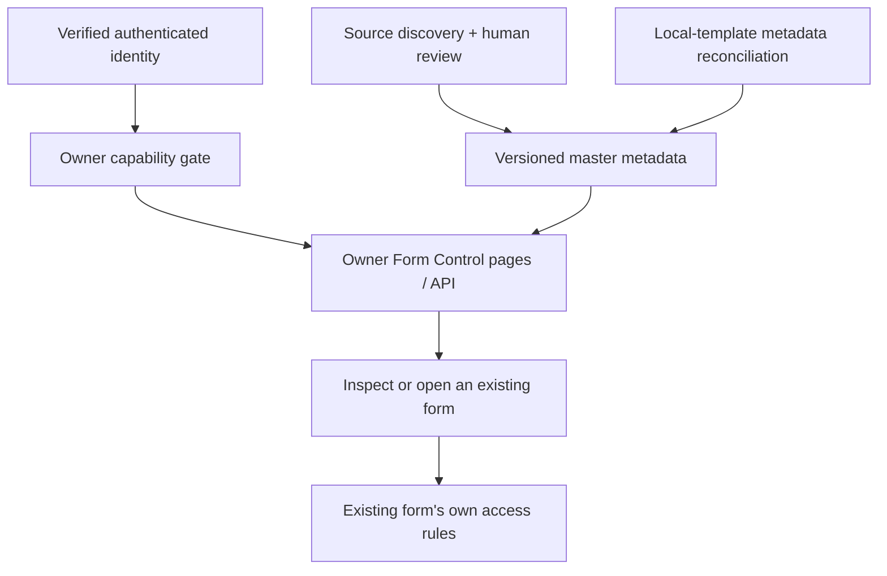

# GSLA-M1-014 — Owner Form Control and Operational Owner Architecture

**Version:** 1.0 architecture proposal for independent review

**Date / Worker:** 2026-10-13 / Software Architect

**Technical baseline:** `7fb6bac897824029cabf68919f706ba3483766bd` on GitHub main

**Authority:** [Issue #52](https://github.com/gibfesta/gsla-new-sdu/issues/52), [Breeze M1-014](https://app.breeze.pm/cards/6537082), and the explicit Work Order. Normal GSLA business permissions remain governed by [v0.2](../data-ownership-and-access.md).

**Status:** Architecture definition produced; acceptance and implementation outstanding. No owner route, guard, metadata register or new role is implemented by this document. No account identifier, form behaviour, persistence connection or database configuration is changed.

## 1. Decision and business meaning

Create an owner-only, metadata-first **Form Control** area, independent of every GSLA department. A form's existence/usefulness and its persistence are separate facts. A deliberately UI-only or browser-local form can be ready for its intended use; a database-linked form can still be unsuitable, on hold or unverified. Do not use connection status as a completion score or a requirement to migrate all forms to PostgreSQL.

Initial Form Control is a read-only register, detail inspector and safe preview/link surface. Updating the register through reviewed source changes does not change a form. This Work Order does not authorise global form creation/edit/delete, reassignment, schema changes or connection toggles. Do not copy the reference page's destructive/action handlers into owner controls merely because the visuals match.

## 2. Current-source audit

Inspected `app/facilities/forms-and-procedures/page.tsx`, `components/facilities/FormsAndProcedures.tsx`, `FacilityFormPreviewer.tsx`, `WorkflowTemplateEditor.tsx`, `EventEditor.tsx`, `WorkflowCompletionForm.tsx`, `WorkflowRecordReview.tsx`, `lib/facilityFormCatalogue.ts`, `lib/facilityWorkflows.ts`, current auth/role/shell code and representative auth, HR, Organisation, SDU, Health and On-Hold sources.

- Facilities reference: grouped sections, List default / Card alternative, GSLA banner, compact rows, editor/preview/assignment views. Its catalogue, assignments and previews use browser-local data; saved venue choices also use the Facilities API. That dependency alone does not make catalogue submissions database-persisted.
- Catalogue baseline has **23 source-default definitions**: eight literal base templates, four generated compliance templates and eleven extra catalogue templates. Browser customisations/additional definitions are not visible to a source-only audit.
- Forms also exist outside that catalogue: Facility create/edit, auth/password/recovery, Organisation user wizards, SDU association/leagues/teams, HR entry actions and disabled previews, uploads and hidden/on-hold screens.
- A source-marker sweep examined **135 UI source files**, including **85 page sources**, and identified **45 candidate source files**. These are source-file counts, not counts of distinct forms. A form may be a wizard or button-driven editor without an HTML form element. Input markers also find filters and search bars.
- HR week creation has a Prisma Server Action while the week-grid editor is a demo. Health's refresh form triggers checks but does not save a health submission. Auth uses an external authentication service; it is not an unconnected form just because it does not use an application table.
- Existing `GslaRole` contains only `organisation_admin`, `facilities_admin`, `centre_manager`. `getAccess()` and existing layouts do not define an owner capability. Middleware verifies sign-in; it does not provide owner-only authorization.
- Current AppShell would give an unknown `/owner` path generic GSLA chrome. Sign-in and `/auth/continue` route by normal roles, and `/account` also expects a recognised GSLA role. These need scoped integration during implementation so an owner-only account need not gain a business role.

The [discovery evidence](OWNER-FORM-CONTROL-DISCOVERY.md) records all candidate paths, all page routes, generated defaults and coverage limitations. It is an audit input, not a populated production master register or certification of complete discovery/runtime persistence.

## 3. Route and component/service boundaries

Recommended routes (all planned):

| Location | Purpose / boundary |
| --- | --- |
| `app/owner/layout.tsx` | Independent owner admission and shell; outside `/organisation` and department layouts |
| `app/owner/page.tsx` → `/owner` | Redirect authorised owner to Form Control; no dashboard needed initially |
| `app/owner/form-control/page.tsx` | Main register, title **Form Control**, eyebrow **Owner / System Control** |
| `app/owner/form-control/[formId]/page.tsx` | Stable, owner-only form details and all usage locations |
| `app/api/owner/form-control/route.ts` | Protected register query / filters / pagination if client fetching is needed |
| `app/api/owner/form-control/[formId]/route.ts` | Protected metadata detail; no raw file-system path input |
| `app/api/owner/form-control/export/route.ts` | Optional protected metadata-only export; never submitted answers or account data |
| `lib/server/owner-access.ts` | Server-only `requireOperationalOwner()` / capability policy adapter |
| `lib/form-control/register.server.ts` | Server-only validated metadata reader; no domain mutation |
| `lib/form-control/types.ts` | Non-sensitive shared types only |
| `components/form-control/*` | Owner shell, register, details, status pills and passive preview |
| `config/form-control/register.json` | Proposed versioned master metadata manifest, loaded only by server module |
| `scripts/form-control/*` | Future offline discovery/reconciliation tooling; no runtime repository crawler |

Do not add owner pages to departmental sidebars. Add AppShell bypass only for exact `/owner` or `/owner/` descendants; unrelated prefixes such as `/ownership` do not match. Reuse passive UI controls (`components/ui`, table/list styles, typography), not Facilities catalogue hooks, mutation handlers or its role selector. Root authentication/display providers must not fetch the owner manifest or make business roles a prerequisite for owner admission. Normal GSLA routes and API permissions stay unchanged.

This is an owner control surface, not a GSLA department or a new grant to perform business operations.

## 4. Temporary Operational Owner admission

The sole principal is one designated authenticated account in the configured Supabase Auth project. Match the **verified account UUID**, not an email address, display name, job title, client storage, user metadata or a submitted header/query value.

Proposed private server configuration names (no real values in source/docs):

- `GSLA_OWNER_CONTROL_ENABLED`: explicit on/off switch; missing/false disables the area.
- `GSLA_OWNER_ACCESS_MODE`: initial value `designated-account`; missing/unrecognised mode denies.
- `GSLA_OPERATIONAL_OWNER_SUBJECT_ID`: exactly one valid account UUID. No lists, wildcards, first-user bootstrap or email fallback. A designated account must be permanent/authenticated, not an anonymous-auth session.

Provision these values through protected deployment configuration and ignored local development settings. Never use a `NEXT_PUBLIC_` variable, tracked config value, seed/migration, public manifest, README, screenshot, task receipt or log for the account identifier. No password, token or service key is needed in this registry. This architecture task does not discover, publish, set or change the designation.

`requireOperationalOwner()` must:
1. Read server-only configuration; validate enablement, mode and single UUID. Invalid/missing configuration fails closed with a generic unavailable response and a restricted configuration error log without identifier values.
2. Verify the request's current authenticated user with the server Supabase client against the configured trusted project; errors/absent identity deny. Do not trust client `getSession()` objects as authorization evidence.
3. Compare that verified subject to the private designation. Roles are not an alternative admission path. A normal GSLA account, including an Organisation Administrator or a multi-role account, fails unless it is the exact designated principal.
4. Return only server-held actor/capability context (`formControl.read`, passive inspection and authorised metadata export). It must not grant Facilities, HR or Organisation actions.
5. Run before loading any owner metadata, HTML/RSC data, export or future server action. Recheck independently in each API handler/action; the layout is defence in depth, not sufficient alone.

Admission truth table:

| Caller / condition | Owner area |
| --- | --- |
| No verified session, expired/invalid auth, anonymous-auth user | Denied |
| Organisation Administrator, Facilities Administrator, Centre Manager, any future GSLA role | Denied on role authority alone |
| Designated verified owner, no normal GSLA role | Allowed when private configuration is valid/enabled |
| Designated owner also has a GSLA role | Allowed by designation; business actions still checked by that separate role |
| Other account with same display name/email metadata, forged owner flag/UUID | Denied |
| Configuration absent, malformed, disabled or unsupported mode | Denied; no automatic admin fallback |

Anonymous browser navigation may redirect to `/sign-in`; authenticated non-owner pages return a generic forbidden result before rendering/loading metadata. APIs return 401 for absent identity, 403 for an authenticated non-owner, and a generic 503 when the feature/configuration is disabled or unavailable. These responses disclose no configuration values, records or counts. All owner data responses use `Cache-Control: private, no-store`; no cross-user cache, ISR/static generation, CDN public cache or cached capability survives a switch of account/designation. Exports and RSC/direct-detail paths receive the same checks.

Navigation: an owner-only link may be derived from a server capability after admission. It never grants access by itself. Do not expose owner links through GSLA role checks. Login integration should use a verified server continuation/capability check first for the designated owner, then the existing GSLA role destinations. The current client role query must not stop the owner-only login flow before that check. Keep non-owner sign-in behaviour equivalent and validate both continuation and direct owner URL paths. No arbitrary `returnTo` redirect; permit only validated local destinations. Owner sign-out/password controls can reuse auth UI without weakening `/account` or creating an Organisation role just to display an account menu.

Concrete continuation contract: after successful authentication, the sign-in client can navigate to the existing `/auth/continue`; its server implementation verifies identity, checks the independent owner policy, and selects `/owner/form-control` only for the designated principal. Otherwise it evaluates existing GSLA roles and preserves `/organisation/home`, `/facilities/home`, `/auth/awaiting-assignment` or `/access-denied`. Shared server helper may be `lib/server/post-login-destination.ts`; no caller-supplied destination or private subject value is returned. This avoids adding an unnecessary public identity endpoint and removes the current client-role-query prerequisite for roleless owner entry. The owner page/API still independently re-authorises every request.

Environment changes apply to the deployment/process that loads them; they do not revoke already-served content or update historical/preview deployments automatically. The configuration-transfer/revocation runbook must redeploy/restart affected instances, disable/remove access to obsolete owner-enabled deployments, clear client owner state, and test the old principal against every accessible endpoint. Do not claim immediate global revocation from editing one environment variable. Auth-service session revocation remains a separately verified auth operation; changing an email does not change UUID designation.

## 5. Future dedicated owner/system role path

Hide admission implementation behind the same capability gate and subject context. After separate approval, replace designated-account policy with a trusted owner/system grant source; keep routes, register IDs, metadata and UI unchanged.

The future role/capability name and grant administration are **proposals**, not production-final. A candidate `operational_owner` grant should be separate from normal GSLA `user_roles` administration: Organisation Administrators must not be able to self-grant owner control through their normal full GSLA user/role rights. Do not add the future role to `GslaRole` and assume that solves the boundary.

Future controlled migration: approve its administration/transfer/revocation model; Senior Database Engineer designs and tests any protected grant storage/RLS/grants; Senior Backend Developer implements live grant evaluation; provision and verify the intended principal privately; switch mode atomically to the new policy; remove the temporary UUID setting. Never admit using `designation OR role`, a fallback policy or an undefined admin inheritance during migration. Prove revocation and normal-GSLA denial before handover. Disable/remove owner control and private designation where required for a GSLA-only handover; do not invent a permanent undisclosed access account.

If the chosen future grant source is unavailable, deny access rather than falling back to the old principal. Ordinary app-role denial does not certify restriction of infrastructure administrators who hold deployment/DB management credentials; their management-plane access is a separate operational responsibility.

## 6. Universal inventory and source-of-truth strategy

Initial master register is a versioned, schema-validated **metadata manifest in GitHub**, exposed through an owner-guarded server read. It needs no new database table and must load even when the business database is unavailable, provided Auth identity verification remains healthy; an Auth outage still denies access. A static file is the register's storage choice; it says nothing about where the listed forms save. Do not import its data into a client module, put it in `/public`, emit a static JSON export or include it in a service worker cache. Only the authorised DTO reaches the owner browser.

The repo is public: server-only runtime access does not make checked-in metadata confidential. Commit only non-personal source/route/schema names and factual implementation evidence that are appropriate for public source. Never put the owner identity, submitted answers, named staff/assignment data, session links, signed URLs, tokens or sensitive free-text notes in this manifest. Private custom metadata belongs in a separately approved private source with its own access boundary; initial public manifest can hold an opaque reference and a coverage-gap note, never fake completeness.

Definition: one stable `formId` per distinct business/auth/system form or purpose, with one or more **usage locations** and **modes/actions**. A shared component rendered at Create and Edit is generally one definition with separate modes; two different behaviours sharing a title are not merged by title. Annual records, venue instances, submitted records and template versions are not new forms. Custom cloned templates with new native IDs remain separate until reviewed equivalence is established. Read-only information views link to their underlying definition and are recorded as display usages. A form-shaped placeholder is included with existence `placeholder`; a README-only future route may be a planned candidate, never an existing form/page.

Discovery and maintenance loop:
1. Enumerate every tracked `app/**/page.tsx`, layout/redirect, component and template-definition source, including On-Hold, unlinked pages, conditionally rendered editors/modals, upload controls, wizards, Server Actions and system-action forms. Do not crawl only sidebars or working database tables.
2. Static discovery proposes candidates from form/control markers, imports and submit/save/create/edit/archive handlers. Resolve page-to-component usage, route groups/dynamic segments, source factories/maps and aliases. Pages with no direct markers still need import/visible-action review; unused form components receive a no-route usage.
3. Classify each candidate as a form definition/usage, information view, placeholder/planned item, or auxiliary search/filter control. Record excluded auxiliary controls with a reason in the coverage ledger. Unknown candidates remain visible as **Needs identification**, not dropped. Source edits/removals make an entry stale/tombstoned, not disappear silently.
4. Expand Facilities source factories into all 23 defaults, preserving native IDs/versions. Relate completion, review, template-edit and assignment forms separately; the renderer is not the form identity. Associate each venue/page usage with the same definition, without a row for every venue or form submission.
5. Trace each mode/action's actual handler and persistence target. Record reads separately from writes, planned vs implemented connections and external services. A venue lookup API or attachment read does not prove the user's submitted answers save to a database.
6. Reconcile browser-created/edited catalogue definitions using explicitly reviewed **metadata-only** local imports or a local metadata adapter in the authorised owner session. Server cannot read another device's localStorage; origin changes and unsynchronised browsers are coverage gaps. Do not automatically collect submitted answers, files, private instructions or personal assignments. Never overwrite the existing catalogue or run its migration hooks to inspect it. Validate/escape imported metadata and retain its device/origin/review provenance privately; cannot claim universal browser completeness until relevant copies are reconciled.
7. Reviewer resolves IDs and provenance, approves manifest updates in a source-controlled change, and validates coverage. Project Controller/QA checks reconciliation counts. Spreadsheets/Drive are useful review/export aids but are not an independently edited second register or live permission authority.

Coverage ledger: every source page has `reviewedAt`, source commit, candidate form IDs, imports reviewed and disposition (`forms mapped`, `information only`, `no form`, `redirect alias`, `needs review`). All nine named area groups plus Shared/Public/Owner controls are represented, even if a group has no current implemented form. Empty Finance placeholders do not become fictitious forms. No sidebar reachability or role-access test excludes a form from inventory.

For initial local discovery, show a separate **Local candidates — this browser, not reconciled** section in the authorised owner page. A no-side-effect adapter may read existing template definitions and extract only reviewed structural metadata; it must not import the live `useCatalogue` hook or migrate/save its storage. A metadata-only upload can stage other-browser candidates in owner memory for review. These overlays are not canonical rows until reconciled, and disappear on logout; approved non-sensitive definitions can then enter the source manifest by PR. Sensitive custom metadata must await an approved private source rather than be published. A **23 source defaults / local copies not reconciled** coverage note is honest; do not label it **all forms verified**.

CI/tooling expectations for later implementation: unique IDs; valid source paths; aliases/modes mapped; page coverage has no unexplained gaps; template factories expanded; candidate additions/deletions flagged for review; claimed connections have cited handlers; contradictory statuses rejected. A regular expression sweep alone cannot pass the complete-inventory gate. Manifests carry baseline commit and schema version; mismatched source commit displays **Inventory needs review**. The evidence ledger and register should be generated/reconciled from the same metadata, not maintained as competing factual lists.

## 7. Metadata contract

Logical schema (design only; physical production file not created here):

| Field / group | Required content |
| --- | --- |
| Identity | `formId` stable namespaced key, displayName, purpose, kind (`data-entry`, `auth`, `template-editor`, `assignment`, `system-action`, `information-view`, `placeholder`) |
| Ownership | area: Organisation / Facilities / SDU / HR / Finance / Health / Login-Auth / On-Hold / Shared-Public / Owner-System; scope: department / venue / shared / account / owner; logical owner |
| Existence | implemented UI / placeholder / planned / removed; source/component paths and optional native template ID/version |
| Locations[] | page route pattern, canonical route/aliases, component/section/modal, mode (`create`, `read`, `edit`, `archive-request`, `approve`, `delete`, other), linked vs unlinked/hidden, route/access context and evidence |
| Per-mode integration | input destination, server route/method or Server Action, read vs write, storage kind, table/model/service and operation, implementation/verification evidence; missing values are explicit unknown/not-applicable |
| Connection intent | intentionally none / browser-only intended / server-service intended / shared-database intended / to decide; policy/owner decision reference, not inferred from current wiring |
| Connection status | simple labels in section 8; declared claim and assessed status recorded separately when not verified |
| Operational status | in use / on hold / deprecated / planned / needs review; distinct from connection |
| Readiness | ready for intended use / work required / not assessed; evidence of the specific form acceptance, not a guessed live-readiness claim |
| Permission context | approved policy reference + declared role/action/scope; observed enforcement/evidence separately; undecided is explicit, no permissions granted by this metadata |
| Evidence | source commit, file/handler reference, reviewed date/role, environment, source-reviewed vs runtime-verified, verification result and gaps |
| Notes | non-sensitive issues, linked task IDs, rationale, coverage gaps; no records/credentials/account identifiers |
| Open/preview | safe route pattern, necessary context keys, same-origin resolved href only when permitted, safe passive-preview availability, disabled reason |
| Governance | metadata schema/version, reviewed revision, provenance source, last verified, stale/tombstone indicator |

Initial list shows **Form name**, **Area/scope**, **Page(s)**, **Connection**, **Operational status**, **Checked?**, and **Inspect / Open**. Expanded detail shows source files, modes/actions, API/service, database/table, connection intention, readiness, permission references and notes/issues. Fields remain available even when null/unknown. Search/group by department, form name, route and source; filters for connection/operational status/verification. An unconnected form is not visually marked as a defect unless it contradicts its approved intention.

Example classification: Facility Information is one definition with Create/Edit/Read locations and database/API implementation evidence; Archive is a distinct disabled action/workflow usage. The event template and browser-saved Event record can share a native template reference but have separate template-edit, create/edit and read usages. The HR week-pack creation and demo WeekGrid have different handlers/statuses; do not label them all persisted merely because their page reads Prisma.

## 8. Independent owner-facing status model

### Connection / where answers or actions go

| Technical value | Owner label | Meaning / evidence rule |
| --- | --- | --- |
| `UI_ONLY` | **Screen only** | No saving/remote action connected; this can be intentional. Verify handler behaviour, not just absence of a table |
| `BROWSER_LOCAL` | **Saved in this browser** | localStorage/IndexedDB/etc in this device/origin; not shared storage. Memory-only edits remain Screen only with temporary-input note |
| `SERVER_SERVICE` | **Server / service connected** | API, Server Action or external service is wired; does not by itself prove application-database saving (auth is a service example) |
| `DATABASE_PERSISTED` | **Saved in database** | Relevant form values/actions confirmed persisted and reopened in the named environment; source-only database wiring is labelled Server/service connected with Database linked, saving not yet verified detail |
| `MIXED` | **Different connections** | Actions/fields have different backing, such as local draft plus database submit or attachments not connected; detail lists each part |
| `UNKNOWN` | **Not checked** | Missing/conflicting/unavailable evidence; absence of evidence is not proof of no connection |

Source-reviewed browser saving may display Saved in this browser with **Code reviewed; reload not tested**. Database persistence requires positive write/read evidence, not database/schema existence or a page fetch. Auth credentials are never captured as registry evidence. Record observed results, environment and timestamp; an outage does not rewrite the implemented architecture to Screen only. Source changes invalidate outdated runtime evidence.

Aggregate rules: one definition with modes using different evidenced backings is MIXED; per-mode labels remain visible. All modes with the same verified backing give that status. An unassessed mode sets an explicit verification gap; label MIXED only when different backings are known, otherwise Not checked and retain known per-mode values. A read-only database information usage is marked Read from database, not proof of form-write persistence. Distinguish a dependent venue lookup from where form answers save.

### Operational status and intention (separate columns)

`IN_USE` = intended to be used now; `ON_HOLD` = retained but deliberately paused; `DEPRECATED` = replaced/retired with replacement reference; `PLANNED` = not yet an implemented form; `NEEDS_REVIEW` = use decision unknown. Connection intent separately records deliberately unconnected or planned integration. For example: **Screen only + In use + intentionally none + ready for intended use** is valid; **Saved in database + On hold** is also valid. Neither On hold nor Deprecated erases known connection history.

No global Complete/Incomplete badge is calculated from database wiring. Readiness must be an explicit review against the agreed intended use. Unknown, on-hold, deprecated, broken-route and hidden entries remain visible, with clear filters and counts whose meaning distinguishes definitions, usages and review candidates.

## 9. UI pattern and safe interaction

Use the Facilities Forms & Procedures visual language: GSLA typography/colour/table styles, grouped sections, List default, Card alternative, compact actions and expandable details. Owner banner reads **Owner / System Control — Form Control** with owner account display and sign-out; no department title/venue assignments. Groups include Organisation, Facilities Department, Venue forms, SDU, HR, Finance, Health, Login/Auth, On-Hold and Shared/Unlinked; one definition can show multiple location chips.

Reference actions are adapted to **Inspect**, **Open form**, **View evidence** and **Preview safely**. No inherited Create/Edit/Delete/Assign template handler, no business submit control and no Connect/Disconnect button. Register metadata changes initially go through the approved development process. Any later in-app metadata editing needs a new controlled scope and durable private storage review, not a hidden write to existing form catalogues.

Open-form action uses a same-origin route and valid current context. Literal `[facilityId]`, `[sport]`, `[id]`, `[eventId]` patterns are never clickable URLs. If no authorised record context is selected, show **Choose a record first**; never insert invented IDs or store real record identifiers in a public manifest. Unlinked but routable forms can be opened; deprecated/on-hold forms show their status and obey existing route rules. No navigation helper bypasses domain permission or grants the owner a GSLA role. A roleless owner can still inspect metadata/passive previews for every form; domain screens may legitimately deny access.

Passive preview renders safe definition metadata or temporary empty values in memory. Do not mount a live component that invokes catalogue migration, localStorage, uploads, invitations, saves or API mutations just to preview it. Where safe preview extraction is unavailable, keep the entry and show Preview not available rather than altering the original form. Imported metadata/notes render as escaped text; route links are allowlisted local paths, evidence links use trusted source/task hosts; no arbitrary URL/file-path fetch or script/HTML evaluation.

## 10. Register API and source maintenance boundary

Initial endpoints are read-only and all call the owner guard before loading data. Optional GET API accepts validated filters, known sort keys and bounded pagination. Detail validates a stable formId from the register; unknown IDs return generic 404 after admission. Export includes metadata only and uses the same guard/cache policy; CSV output prevents spreadsheet formula injection. No unauthorised caller can obtain metadata via download, RSC, preview, default exports or a direct JSON asset.

Server module schema-validates the versioned manifest at load, returns an owner DTO and identifies malformed entries without silently dropping forms. Runtime does not scan source directories or probe business APIs/databases to infer connections. No refresh request creates records, modifies schema, imports business data or verifies a form by submitting it. **Refresh register** only re-reads metadata; **Check connection** is not an automatic production mutation. Runtime persistence tests require separately authorised fixtures and specialist evidence.

Future adapter model: `loadFormRegister()` is independent from `requireOperationalOwner()` and from any domain forms database. If persistent owner metadata is later justified, replace the metadata repository behind that contract; retain IDs/status fields. Do not build this database or its grants now. Register updates and form-integration changes can proceed separately: integrations update their evidence/mode metadata under a new controlled work order, not as a side effect of changing the label in Form Control.

## 11. Existing Facilities register and database work

[Facilities Forms Integration Register](FACILITIES-FORMS-INTEGRATION-REGISTER.md) remains the Facilities-specific implementation plan/contract. `lib/facilityFormCatalogue.ts` remains the current source/browser catalogue and controls its own form definitions/assignments. The universal register references both with stable native IDs and usage/evidence links; it neither replaces them nor merges their save mechanisms. The forms register's page itself has template editing/assignment forms that also belong in Form Control.

Universal metadata becomes the single cross-app inventory of form identities/usages/status evidence. Department registers own implementation details; no copy of their entire schema/workflow narrative. Handbook links to the two purposes. During future database work, retain browser customisations, do not assume database submissions exist, and update the universal register only when evidence supports the new label. An intentional no-database choice does not block a form's intended UI release. Conversely, a form intended for shared operational records is not operationally ready simply because its UI looks finished.

This architecture has **no dependency on completing M1-010/M1-011 Facilities database/approval work** to display current form metadata. It must truthfully show those integrations as planned/partial/unverified. No schema, table, RLS/grant or current submission behaviour is changed. HR/Finance/SDU deferred permissions remain deferred; registration is visibility to the owner of metadata, not permission to operate their records.

## 12. Handoff, migration and specialist dependencies

| Controlled follow-up candidate | Specialist / boundary | Required evidence |
| --- | --- | --- |
| Owner admission/server metadata reader | Senior Backend Developer | Authenticated designated-owner success, all normal-role/anonymous denial, missing config, RSC/API/export/caching tests, private configuration and no leaked identifier |
| Universal inventory reconciliation | Backend/Frontend source reviewers; Senior Data Steward if private/browser definitions need reconciliation | 85-page baseline reconciled plus import/unused-component/action/template review, all 23 defaults, aliases and browser gaps; no statement that 45 files equals 45 forms |
| Owner register interface | Frontend Developer | Reference-consistent List/Card/group/detail UI, independent labels, missing dynamic context handling, passive preview without side effects, no departmental owner links |
| Independent acceptance | QA / Tester | Role and account-switch negative tests; source-to-register coverage review; unchanged existing form/persistence behaviour |
| Future owner grants / metadata DB only if separately approved | Senior Database Engineer + Backend | Protected identity/grant/metadata storage, RLS/grants/direct privileged paths, migration/revocation/transfer tests; no ordinary GSLA role self-grant |

Private account designation/environment provisioning is required for runtime implementation tests but not for this architecture definition. Use a secure configuration workflow, never copy the owner identifier into chat/public tasks. The Backend Developer validates its actual configured Auth identity. Database Engineer review is mandatory if a future table/grant/role change is introduced; a read-only source manifest and UUID configuration do not require inventing new tables.

Release sequence: Owner/Controller accepts architecture; Backend implements guard + manifest contract; reviewers reconcile all candidates and local metadata limitations; Frontend renders the authorised DTO; QA tests independent owner and domain boundaries; Controller verifies before deployment/task closure. Feature stays disabled until designation and denial tests pass. Rollback disables owner control/routes and retains manifest/history; it does not disconnect or erase existing forms. Source metadata and domain data remain independently recoverable.

## 13. Required implementation acceptance tests

These are future acceptance specifications, not live test results.

| ID | Scenario | Expected result |
| --- | --- | --- |
| O01 | Designated verified permanent user with no GSLA role | Owner page/register allowed; no automatic domain rights |
| O02 | Ordinary OA/FA/CM and any unrecognised or future role, including multi-role | Owner page/API/detail/export denied unless independently designated |
| O03 | Anonymous, expired/forged session, forged subject/header/metadata | No owner content; 401/403 as applicable |
| O04 | Missing/invalid/list UUID, disabled toggle, invalid policy mode/auth failure | Fail closed with no admin/email fallback or configuration leak |
| O05 | Direct API/RSC/child-page/export/download attempt bypassing layout | Independent owner checks before data load; no static JSON/client-bundle leakage |
| O06 | Owner logs out or browser changes to normal account | Clear owner DTO/state; protected requests denied; no shared cache leak |
| O07 | Designation removed/changed, updated deployment and obsolete deployments disabled; old owner retries | All accessible endpoints deny old principal; no cached grant or automatic fallback; retain evidence for each deployment |
| O08 | No application database connectivity | Register metadata still loads for owner; connection evidence shows its real confidence, not fabricated current health |
| O09 | Intentionally Screen only or Browser saved form | Remains visible; readiness assessed against intention, not forced incomplete |
| O10 | Local draft + database submit + disconnected attachment | Per-action/field facts visible; Mixed connection label and evidence gaps |
| O11 | Schema exists/read succeeds but no verified form-save round trip | Cannot display verified Saved in database for the form's write action |
| O12 | On-Hold, deprecated, hidden/unlinked, alias routes | Retained entries and clear lifecycle; aliases do not duplicate definitions; domain guards still apply |
| O13 | All pages/imported editors/unused forms/generated defaults reviewed | Ledger accounts for every source, 23 defaults, unknown candidates and Finance planned placeholders; no unexplained omission |
| O14 | One renderer across venues and Create/Edit modes | Stable definition identity, multiple usages; neither duplication per submission nor conflation by title |
| O15 | Browser custom form on another device/origin not reconciled | Coverage limitation shown; no false all-forms claim; metadata-only review preserves existing local data |
| O16 | Dynamic route without context or owner lacks domain role | Open disabled/explained or existing domain denial; no invented ID/bypass |
| O17 | Inspect/preview/refresh Form Control | No business API mutation/localStorage migration, invitation, upload or connection change |
| O18 | Malicious imported title/note/href/file path/export cell | Escaped/validated output; no script execution, SSRF/path traversal or spreadsheet formula execution |
| O19 | Source commit differs or handler removed | Stale evidence/tombstone visible; no silent removal or unsupported persistence claim |
| O20 | Future grant switch / store unavailable / OA attempts self-grant | Controlled explicit mode, ordinary admin denied, revocation verified, failed store denies; no temporary-principal OR-role fallback |
| O21 | Ordinary public/source/bundle scan for designation | No personal email/account UUID or private owner config value in public artifacts |

## 14. Architect verification and remaining dependencies

Completed architectural checks: independent owner-vs-GSLA admission; valid configuration failure paths; identity/mode migration boundaries; login/shell/API/RSC/export/cache coverage; universal source/usage/template/browser discovery; non-conflated lifecycle/persistence/readiness; native identity/alias rules; passive UI reuse; existing Facilities/DB work coexistence; domain privilege preservation; specialist referral and 21 acceptance cases.

No production owner gate, complete canonical manifest, account configuration, browser reconciliation, authenticated negative tests or database security certification is claimed. These are downstream implementation/review dependencies. No blocker prevents delivery of this architecture proposal. Project Controller independently reviews specialist evidence and disposition before Done.

Technical references reviewed 2026-10-13: [Next.js authorization boundaries](https://nextjs.org/docs/app/guides/authentication), [Next.js environment-variable exposure](https://nextjs.org/docs/app/guides/environment-variables), [Supabase verified getUser](https://supabase.com/docs/reference/javascript/auth-getuser). References inform the proposed controls; they do not certify deployed GSLA behaviour.
